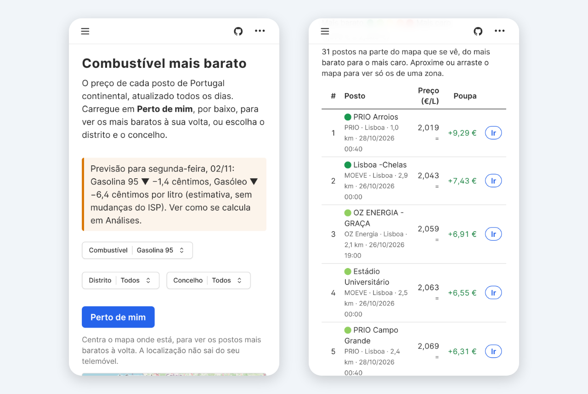
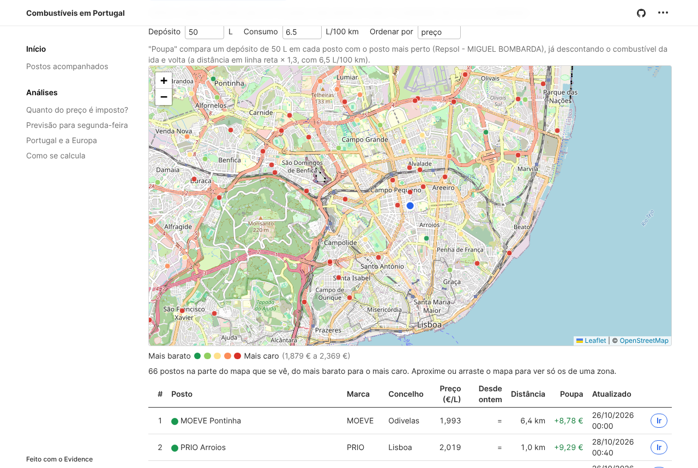
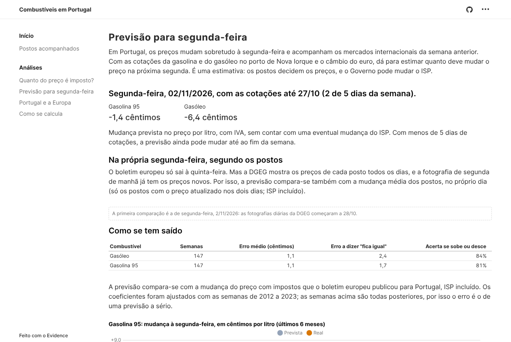
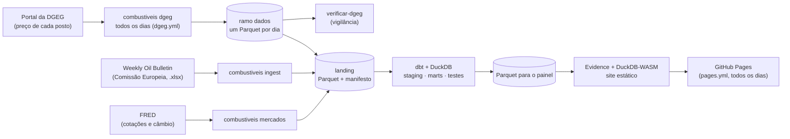

# combustiveis-pt

[](https://github.com/JoseFerrao20/combustiveis-pt/actions/workflows/ci.yml)
[](LICENSE)

**Onde abastecer mais barato, e quanto do preço é imposto.** Um pipeline de dados que junta, todos os dias, o preço de cada posto de combustível em Portugal (DGEG), os preços semanais de toda a UE desde 2005 (Weekly Oil Bulletin da Comissão Europeia) e as cotações dos mercados internacionais (FRED), e um site estático feito para se usar no telemóvel.

**Site:** [joseferrao20.github.io/combustiveis-pt](https://joseferrao20.github.io/combustiveis-pt/), atualizado todos os dias.



**Para quem abastece:**

- **Mapa e tabela de todos os postos** (mais de 3000), do mais barato para o mais caro. A tabela segue o mapa: ao aproximar, ou ao escolher o distrito e o concelho, fica só com os postos que se veem.
- **"Perto de mim":** centra o mapa onde a pessoa está. Para cada posto, mostra a distância e quanto se poupa num depósito face ao posto mais perto, já descontando a ida e volta. O botão "Ir" abre o caminho no Google Maps. A localização não sai do telemóvel.
- **"Desde ontem":** quanto cada posto subiu ou desceu, e os preços dos últimos dias.
- **Previsão para segunda-feira:** quanto deve mudar o preço, a partir dos mercados da semana anterior, com o erro de todas as semanas desde 2024 à vista. Na segunda de manhã, compara-se com a mudança real nos postos.



**Para quem quer perceber os preços:** na semana de 19/10/2026, um litro de gasolina 95 custava 2,099 € em Portugal.

| | € por litro |
|---|---|
| Produto (antes de impostos) | 1,122 |
| ISP (imposto sobre os produtos petrolíferos) | 0,426 |
| Outros impostos (contribuição de serviço rodoviário, carbono) | 0,159 |
| IVA (23 %) | 0,392 |
| **Preço** | **2,099** |

Quase **47 %** do preço são impostos. A decomposição bate certo com o preço publicado ao cêntimo, e essa verificação faz parte dos testes. O menu "Análises" do site tem a evolução desde 2005, a comparação com a Europa e a previsão.




## Destaques técnicos

- **Fontes sem contrato, lidas com desconfiança.** O ficheiro do boletim não tem formato documentado, e a API da DGEG é a da página de pesquisa, sem documentação. Cada leitura valida o que recebe (colunas, códigos, totais anunciados) e falha com um erro claro em vez de devolver dados errados (`FormatError`, `DgegFormatError`, `MarketFormatError`).
- **Histórico que a fonte não guarda.** A DGEG só mostra o preço em vigor. Uma fotografia por dia vai para o ramo `dados` do próprio repositório (o padrão "git scraping"), sem serviços nem custos. Uma vigilância avisa por email se a recolha parar ou vier incompleta.
- **SQL a fazer o trabalho pesado** (dbt com DuckDB): o imposto em vigor em cada semana com `ASOF JOIN`; os concorrentes a 2 e 5 km de cada posto com a fórmula de haversine, sem extensões; as mudanças diárias de cada posto com funções de janela.
- **Erros da fonte investigados, não escondidos.** Quando as tabelas de impostos do boletim não explicam o preço, a diferença fica numa coluna. Os períodos já explicados ficam num seed, com a razão, e a análise está em [`docs/analises/`](docs/analises/) (Portugal, Lituânia, Países Baixos, Eslováquia e Espanha). Um aviso do dbt apanha qualquer caso novo.
- **Uma previsão testada a sério.** Os coeficientes foram ajustados com 2012–2023, e o site mostra o erro em todas as semanas desde 2024, que o ajuste não viu: 1,1 a 1,3 cêntimos, contra 1,7 a 2,7 a dizer "fica igual".
- **Um site sem servidor:** Evidence com DuckDB-WASM no browser, publicado no GitHub Pages. O mapa é um componente próprio com o Leaflet, porque o do Evidence não diz à página que zona está à vista. A interface foi traduzida com patches ao Evidence. As fontes e as consultas foram cortadas ao que as páginas usam.
- **Testes em todas as camadas**, todos no CI:
  - 57 testes em Python (98 % de cobertura);
  - 83 testes de dados e testes unitários no dbt;
  - 33 testes do site com o Playwright: as páginas, os filtros, o "Perto de mim" com a localização simulada e a poupança, e a acessibilidade de todas as páginas (axe, WCAG 2.2 AA) nos temas claro e escuro.

  O CI corre tudo com amostras reais das três fontes, e o site publica-se sozinho todas as manhãs.

## Arquitetura



| Fase | Estado |
|---|---|
| **Ingestão**: descarrega o histórico, passa as folhas "largas" (uma coluna por país) a tabelas "longas" e escreve Parquet, com um manifesto (origem, data, SHA-256) | ✅ |
| **Transformação**: modelos dbt em DuckDB (staging, imposto em vigor em cada semana com `ASOF JOIN`, decomposição do preço), testes de dados e testes unitários do dbt | ✅ |
| **Painel**: site estático com o Evidence no GitHub Pages: os postos, a divisão do preço, a evolução desde 2005 e a comparação com a Europa | ✅ |
| **Agendamento**: o GitHub Actions corre tudo todos os dias, e falha (com email) se o boletim deixar de ser atualizado ou se as fotografias da DGEG pararem | ✅ |
| **Postos em Portugal**: fotografia diária dos preços de cada posto (portal da DGEG), guardada no ramo `dados`; no painel, o mapa com a tabela, "Perto de mim", a poupança, o caminho no Google Maps, "Desde ontem" e as médias por grupo de marcas, marca e distrito ([ADR 0003](docs/adr/0003-precos-dos-postos-dgeg.md)) | ✅ |
| **Previsão de segunda-feira**: a partir das cotações da gasolina e do gasóleo em Nova Iorque (FRED), comparada com o boletim e com os postos na própria segunda ([análise](docs/analises/previsao-segunda-feira.md), [ADR 0004](docs/adr/0004-previsao-com-cotacoes-do-fred.md)) | ✅ |
| **Postos acompanhados**: alguns postos seguidos dia a dia (seed `tracked_stations`: o Auchan da Circunvalação, no Porto, e o de Viseu), com a posição entre os concorrentes a 5 km e a média do concelho | ✅ |

**Decisões** (uma por ficheiro, em [`docs/adr/`](docs/adr/)):

- [0001](docs/adr/0001-fonte-weekly-oil-bulletin.md): o Weekly Oil Bulletin como fonte principal;
- [0002](docs/adr/0002-painel-evidence.md): o painel com o Evidence;
- [0003](docs/adr/0003-precos-dos-postos-dgeg.md): os preços de cada posto, em fotografias diárias da DGEG;
- [0004](docs/adr/0004-previsao-com-cotacoes-do-fred.md): a previsão de segunda-feira com as cotações do FRED.

O histórico de cada sessão de trabalho, com as decisões e as lições, está no [`DEVLOG.md`](DEVLOG.md).

## Correr

Com o [uv](https://docs.astral.sh/uv/):

```bash
uv sync
uv run combustiveis ingest                         # descarrega e escreve data/landing/
uv run combustiveis ingest --ficheiro historico.xlsx   # a partir de um ficheiro já descarregado
uv run combustiveis ingest --idade-maxima 15          # falha se a última semana tiver mais de 15 dias
uv run combustiveis dgeg                           # fotografia de hoje dos postos (data/landing/dgeg/)
uv run combustiveis verificar-dgeg                 # o histórico da DGEG está em dia?
uv run combustiveis mercados                       # cotações e câmbio do FRED, para a previsão
```

A camada landing fica em `data/landing/`: `prices.parquet` (semana, país, produto, com ou sem impostos, valor por 1000 L), `taxes.parquet` (IVA, ISP e outros impostos, com a data de entrada em vigor) e `manifest.json`.

Depois, a transformação com o dbt (escreve `data/warehouse.duckdb`):

```bash
uv sync --all-groups
uv run dbt build --project-dir transform --profiles-dir transform
```

O resultado é a tabela `fct_fuel_prices`, uma linha por semana, país e produto:

| Coluna | O que é |
|---|---|
| `price_with_tax`, `price_without_tax` | preços publicados, em € por 1000 L (por tonelada nos fuelóleos) |
| `vat_rate`, `vat_amount` | taxa de IVA em vigor nessa semana e o IVA incluído no preço |
| `excise_and_other_taxes` | ISP e outros impostos: o resto da diferença entre os dois preços |
| `taxes_total`, `tax_share` | todos os impostos e a parte do preço que representam |
| `reported_excise`, `reported_other_taxes`, `tax_tables_gap` | o ISP e os outros impostos das tabelas do boletim, e quanto ficam longe do valor acima (só a partir da entrada no euro, porque as tabelas estão na moeda nacional) |
| `tax_tables_issue` | quando a diferença já foi investigada, a explicação (por exemplo, tabelas da Lituânia que ficaram em litas depois do euro) |

A decomposição soma sempre o preço; quando as tabelas de impostos do boletim não a explicam, a diferença fica à vista em `tax_tables_gap`, em vez de escondida. As diferenças de Portugal, da Lituânia, dos Países Baixos, da Eslováquia e de Espanha estão explicadas em [`docs/analises/`](docs/analises/): em Portugal, por exemplo, a tabela de outros impostos tem valores com um algarismo a menos (12,15 € em vez de 102,15 €).

O dbt exporta também `data/road_fuel_prices.parquet` (gasolina 95, gasóleo e GPL, em € por litro) para o painel. O painel (`dashboard/`, com o [Evidence](https://github.com/evidence-dev/evidence)) corre com o Node 22:

```bash
cd dashboard
npm ci
npm run sources                                    # lê o Parquet (precisa de acesso a extensions.duckdb.org)
npm run dev                                        # abre o painel no browser
```

O workflow `pages.yml` faz tudo a cada push na `main` e todos os dias de manhã: descarrega o boletim, junta as fotografias diárias da DGEG (workflow `dgeg.yml`, ramo `dados`), corre o dbt e publica o painel no GitHub Pages. Se o boletim não tiver uma semana dos últimos 15 dias, ou se um teste do dbt falhar, a execução falha e o GitHub avisa por email; o painel fica com os dados da última execução boa.

## Desenvolvimento

```bash
uv run pytest                                      # testes, cobertura ≥ 90 %
uv run ruff check . && uv run ruff format --check . && uv run mypy
```

Os testes usam uma amostra do ficheiro real (`tests/fixtures/oil_bulletin_sample.xlsx`, gerada com `scripts/make_sample.py`), com o mesmo formato: se a Comissão mudar o ficheiro, é aí que se vê. O CI corre também o `dbt build` e o build do painel com essa amostra, e abre cada página do painel com o Playwright (`dashboard/tests/`): sem erros de JavaScript, com números, e com os filtros de distrito e de posto a funcionar.

No dbt (`transform/`):

- **testes de dados**: chaves únicas e não nulas, valores aceites, relações com os países e produtos (seeds), e o preço com impostos nunca abaixo do preço sem impostos;
- **testes unitários** do dbt sobre a decomposição, com valores escritos à mão (incluindo o preço português de 19/10/2026);
- **erros conhecidos da fonte** no seed `known_source_errors`, cada um com a explicação: os testes ignoram essas semanas, e um erro novo faz falhar o build;
- **um aviso** (não falha) quando as tabelas de ISP e de outros impostos não explicam o preço em Portugal, na Lituânia, nos Países Baixos, na Eslováquia ou em Espanha, fora dos períodos já explicados no seed `known_tax_table_issues`.

## Fonte e licença

Dados: © União Europeia, [Weekly Oil Bulletin](https://energy.ec.europa.eu/data-and-analysis/weekly-oil-bulletin_en), reprodução autorizada com indicação da fonte. Os preços são médias nacionais ponderadas, não os de um posto.

Cotações e câmbio: [FRED](https://fred.stlouisfed.org/), Federal Reserve Bank of St. Louis (U.S. Energy Information Administration e Federal Reserve).

Preços de cada posto: Direção-Geral de Energia e Geologia, [Preços dos Combustíveis Online](https://precoscombustiveis.dgeg.gov.pt), de reutilização livre com indicação da fonte e da data e hora de atualização de cada preço (que o painel mostra). Os preços são os que os postos comunicam.

Código: [MIT](LICENSE).
