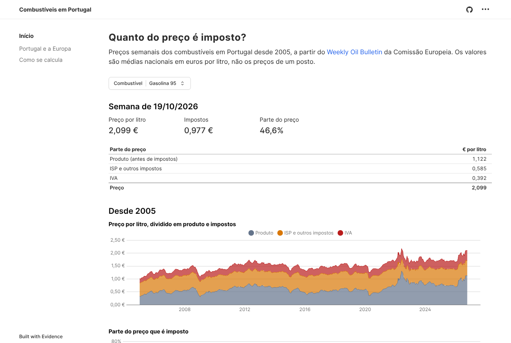
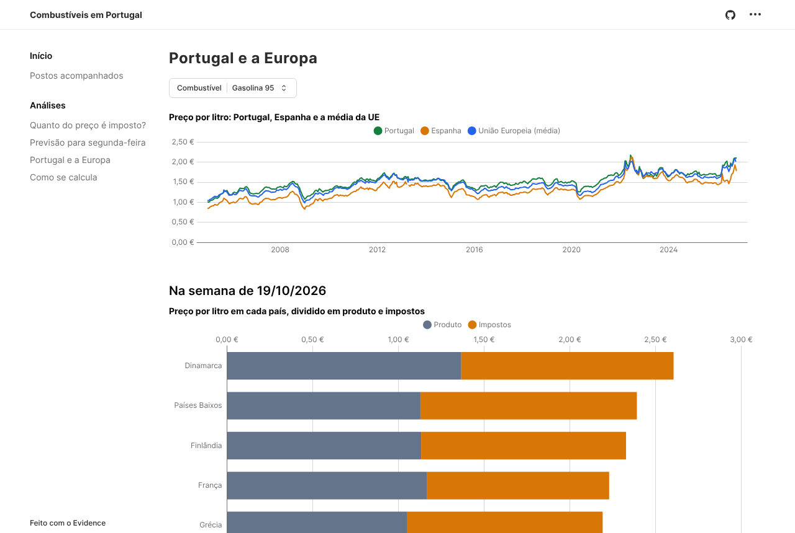
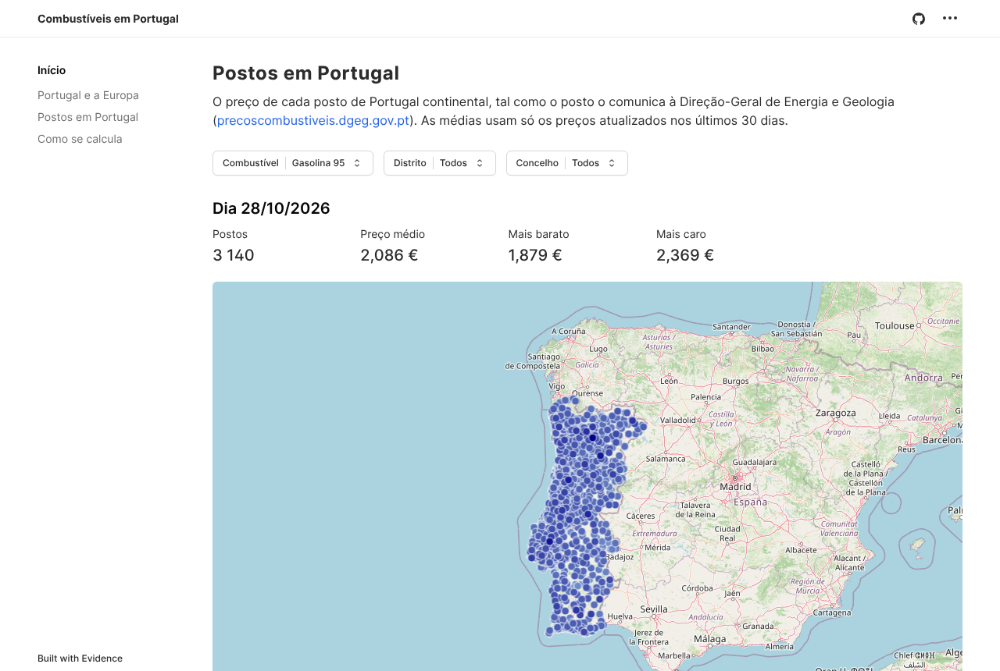
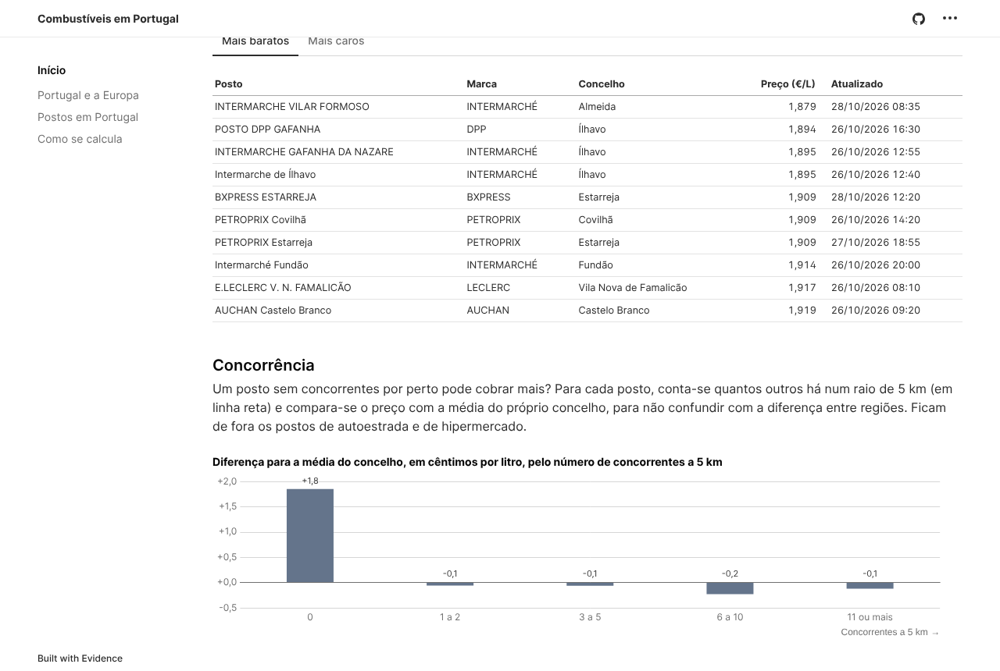
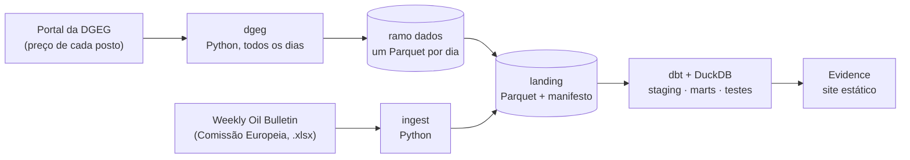

# combustiveis-pt

[](https://github.com/JoseFerrao20/combustiveis-pt/actions/workflows/ci.yml)
[](LICENSE)

**Quanto do que pagas por um litro de gasolina é imposto?** Um pipeline de dados com os preços semanais dos combustíveis em Portugal e nos outros países da UE desde 2005, a partir do [Weekly Oil Bulletin](https://energy.ec.europa.eu/data-and-analysis/weekly-oil-bulletin_en) da Comissão Europeia.

Na semana de 19/10/2026, um litro de gasolina 95 custava 2,099 € em Portugal:

| | € por litro |
|---|---|
| Produto (antes de impostos) | 1,122 |
| ISP (imposto sobre os produtos petrolíferos) | 0,426 |
| Outros impostos (contribuição de serviço rodoviário, carbono) | 0,159 |
| IVA (23 %) | 0,392 |
| **Preço** | **2,099** |

Quase **47 %** do preço são impostos. A decomposição bate certo com o preço publicado ao cêntimo, e essa verificação faz parte dos testes.

**Painel:** [joseferrao20.github.io/combustiveis-pt](https://joseferrao20.github.io/combustiveis-pt/), atualizado todos os dias.









## Perguntas

- Quanto do preço é imposto, e como mudou desde 2005?
- Portugal comparado com Espanha e com a média da UE e da zona euro.
- O efeito das mudanças do ISP (por exemplo, as descidas de 2022).
- Em Portugal, posto a posto: quanto mais caras são as petrolíferas do que os hiper e supermercados, e que distritos pagam mais (dados da DGEG, uma fotografia por dia).

## Arquitetura



| Fase | Estado |
|---|---|
| **Ingestão**: descarrega o histórico, passa as folhas "largas" (uma coluna por país) a tabelas "longas" e escreve Parquet, com um manifesto (origem, data, SHA-256) | ✅ |
| **Transformação**: modelos dbt em DuckDB (staging, imposto em vigor em cada semana com `ASOF JOIN`, decomposição do preço), testes de dados e testes unitários do dbt | ✅ |
| **Painel**: site estático com o Evidence no GitHub Pages ([joseferrao20.github.io/combustiveis-pt](https://joseferrao20.github.io/combustiveis-pt/)): a divisão do preço, a evolução desde 2005 e a comparação com a Europa | ✅ |
| **Agendamento**: o GitHub Actions corre tudo todos os dias, e falha (com email) se o boletim deixar de ser atualizado | ✅ |
| **Postos em Portugal**: fotografia diária dos preços de cada posto (portal da DGEG), guardada no ramo `dados`; no painel, um mapa e as médias por grupo de marcas, marca e distrito ([ADR 0003](docs/adr/0003-precos-dos-postos-dgeg.md)) | ✅ |

Decisões: a fonte em [`docs/adr/0001-fonte-weekly-oil-bulletin.md`](docs/adr/0001-fonte-weekly-oil-bulletin.md) e o painel em [`docs/adr/0002-painel-evidence.md`](docs/adr/0002-painel-evidence.md).

## Correr

Com o [uv](https://docs.astral.sh/uv/):

```bash
uv sync
uv run combustiveis ingest                         # descarrega e escreve data/landing/
uv run combustiveis ingest --ficheiro historico.xlsx   # a partir de um ficheiro já descarregado
uv run combustiveis ingest --idade-maxima 15          # falha se a última semana tiver mais de 15 dias
uv run combustiveis dgeg                           # fotografia de hoje dos postos (data/landing/dgeg/)
```

A camada landing fica em `data/landing/`: `prices.parquet` (semana, país, produto, com ou sem impostos, valor por 1000 L), `taxes.parquet` (IVA, ISP e outros impostos, com a data de entrada em vigor) e `manifest.json`.

Depois, a transformação com o dbt (escreve `data/warehouse.duckdb`):

```bash
uv sync --all-groups
uv run dbt build --project-dir transform --profiles-dir transform
```

O resultado é a tabela `fct_fuel_prices`, uma linha por semana, país e produto:

| Coluna | O que é |
|---|---|
| `price_with_tax`, `price_without_tax` | preços publicados, em € por 1000 L (por tonelada nos fuelóleos) |
| `vat_rate`, `vat_amount` | taxa de IVA em vigor nessa semana e o IVA incluído no preço |
| `excise_and_other_taxes` | ISP e outros impostos: o resto da diferença entre os dois preços |
| `taxes_total`, `tax_share` | todos os impostos e a parte do preço que representam |
| `reported_excise`, `reported_other_taxes`, `tax_tables_gap` | o ISP e os outros impostos das tabelas do boletim, e quanto ficam longe do valor acima (só a partir da entrada no euro, porque as tabelas estão na moeda nacional) |
| `tax_tables_issue` | quando a diferença já foi investigada, a explicação (por exemplo, tabelas da Lituânia que ficaram em litas depois do euro) |

A decomposição soma sempre o preço; quando as tabelas de impostos do boletim não a explicam, a diferença fica à vista em `tax_tables_gap`, em vez de escondida. As diferenças de Portugal, da Lituânia, dos Países Baixos, da Eslováquia e de Espanha estão explicadas em [`docs/analises/`](docs/analises/): em Portugal, por exemplo, a tabela de outros impostos tem valores com um algarismo a menos (12,15 € em vez de 102,15 €).

O dbt exporta também `data/road_fuel_prices.parquet` (gasolina 95, gasóleo e GPL, em € por litro) para o painel. O painel (`dashboard/`, com o [Evidence](https://github.com/evidence-dev/evidence)) corre com o Node 22:

```bash
cd dashboard
npm ci
npm run sources                                    # lê o Parquet (precisa de acesso a extensions.duckdb.org)
npm run dev                                        # abre o painel no browser
```

O workflow `pages.yml` faz tudo a cada push na `main` e todos os dias de manhã: descarrega o boletim, junta as fotografias diárias da DGEG (workflow `dgeg.yml`, ramo `dados`), corre o dbt e publica o painel no GitHub Pages. Se o boletim não tiver uma semana dos últimos 15 dias, ou se um teste do dbt falhar, a execução falha e o GitHub avisa por email; o painel fica com os dados da última execução boa.

## Desenvolvimento

```bash
uv run pytest                                      # testes, cobertura ≥ 90 %
uv run ruff check . && uv run ruff format --check . && uv run mypy
```

Os testes usam uma amostra do ficheiro real (`tests/fixtures/oil_bulletin_sample.xlsx`, gerada com `scripts/make_sample.py`), com o mesmo formato: se a Comissão mudar o ficheiro, é aí que se vê. O CI corre também o `dbt build` e o build do painel com essa amostra, e abre cada página do painel com o Playwright (`dashboard/tests/`): sem erros de JavaScript, com números, e com o filtro de distrito a funcionar.

No dbt (`transform/`):

- **testes de dados**: chaves únicas e não nulas, valores aceites, relações com os países e produtos (seeds), e o preço com impostos nunca abaixo do preço sem impostos;
- **testes unitários** do dbt sobre a decomposição, com valores escritos à mão (incluindo o preço português de 19/10/2026);
- **erros conhecidos da fonte** no seed `known_source_errors`, cada um com a explicação: os testes ignoram essas semanas, e um erro novo faz falhar o build;
- **um aviso** (não falha) quando as tabelas de ISP e de outros impostos não explicam o preço em Portugal, na Lituânia, nos Países Baixos, na Eslováquia ou em Espanha, fora dos períodos já explicados no seed `known_tax_table_issues`.

## Fonte e licença

Dados: © União Europeia, [Weekly Oil Bulletin](https://energy.ec.europa.eu/data-and-analysis/weekly-oil-bulletin_en), reprodução autorizada com indicação da fonte. Os preços são médias nacionais ponderadas, não os de um posto.

Preços de cada posto: Direção-Geral de Energia e Geologia, [Preços dos Combustíveis Online](https://precoscombustiveis.dgeg.gov.pt), de reutilização livre com indicação da fonte e da data e hora de atualização de cada preço (que o painel mostra). Os preços são os que os postos comunicam.

Código: [MIT](LICENSE).
